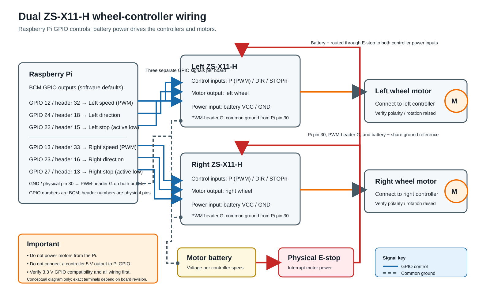
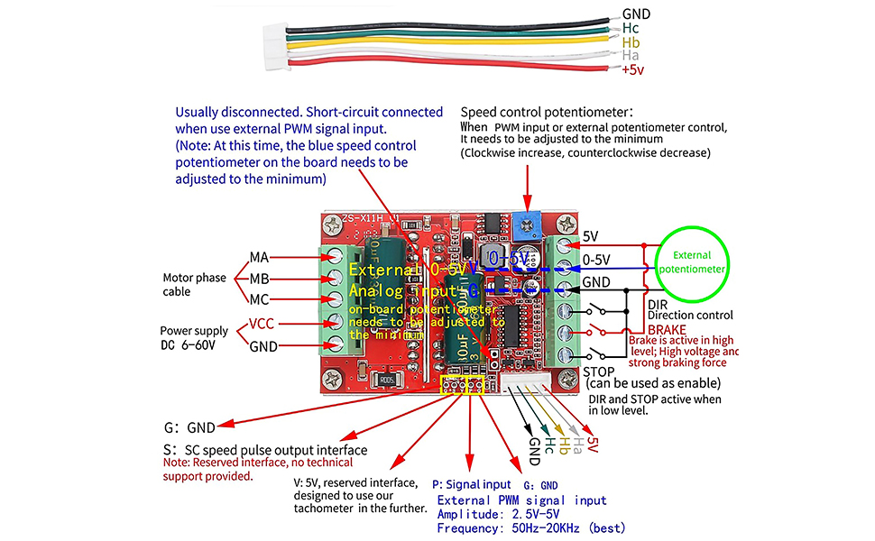
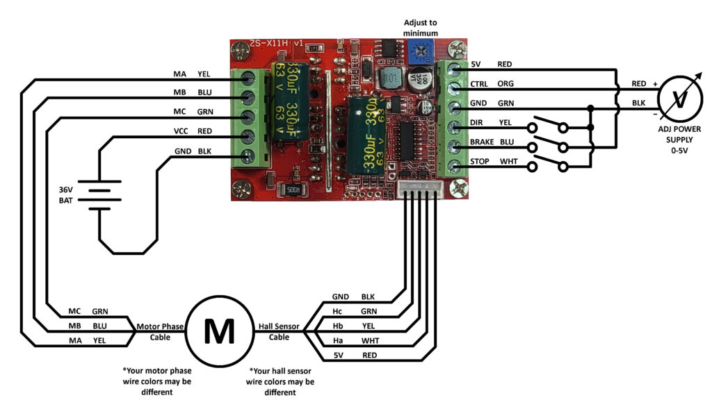

# Phase 2: manual RC motor control

Phase 2 supports two mutually exclusive RC drive targets on the same Raspberry Pi:

- Roboteq MDC2250: `Taranis X9 Lite → XM+ SBUS → Raspberry Pi → USB serial → Roboteq`
- Pair of RioRand ZS-X11-H boards: `Taranis X9 Lite → XM+ SBUS → Raspberry Pi GPIO → ZS-X11-H pair`

Start the executable manually with exactly one `--controller` target. It opens and commands only the selected controller; do not run two instances or switch targets while a model is connected. There is no installed, enabled, or required drive service. The existing `roberta_rc_monitor` remains available for checking all SBUS channels without opening a motor controller.

## Safety before connecting drive power

- Keep the frame securely raised with both drive wheels clear of the ground for initial tests. Keep people, cables, and loose items clear of the wheels.
- Have a verified, independent physical motor-power emergency stop immediately accessible. Do not rely on Ctrl-C, the radio failsafe, or this program as the only emergency stop.
- Verify the Roboteq's serial protocol, baud rate, channel operating modes, motor wiring, and motor/controller configuration against the MDC2250 documentation and this robot's wiring. In particular, verify the controller's command watchdog/failsafe behavior for a disconnected or crashed host before powering the motors.
- For the ZS-X11-H boards, verify the speed, direction, and stop connections against the board documentation and the robot wiring. The defaults below are carried over from the previous-version controller source and are not proof of the current wiring. The board reference shows a 50 Hz–20 kHz external PWM input, a 2.5–5 V PWM signal, and low-level direction/stop control. The Pi outputs 3.3 V logic; verify that the exact board version recognizes it. Never connect a board 5 V output to a Pi GPIO.
- Before using external PWM on a ZS-X11-H, follow its instructions for disabling/minimizing its on-board speed potentiometer. Test one board at a time with the drive wheels raised, the physical emergency stop ready, and the low PWM cap in place.
- Verify wheel direction with the drive wheels raised and the motor command limit kept low. Stop and correct the channel inversion/wiring if a wheel turns the wrong way. Do not test direction with the wheels on the ground.
- Keep transmitter failsafe configured to stop the receiver outputs. The runtime rejects SBUS failsafe and lost-frame data, stops both motor outputs when the link goes stale, and disarms after link loss. A restored link does not resume motion: both sticks must be neutral for the configured arm hold time.

The program can command motor torque. A raised frame reduces the risk of unintended vehicle motion but does not eliminate pinch, entanglement, or electrical hazards.

The ZS-X11-H schematic shows separate DIR, BRAKE, and STOP terminals. The software's GPIO 22/27 outputs control STOP; connect them to the STOP terminals, not BRAKE. The driver does not control BRAKE. The `images/zs-x11h-wiring.jpg` reference labels `P` as the external PWM signal input and `G` as its ground. For external PWM, it says the selection link is normally disconnected and should be short-circuited, and that the on-board speed potentiometer should be turned fully down to minimum. The wiring reference says DIR and STOP are active-low and specifies 2.5–5 V PWM at 50 Hz–20 kHz. The Pi's 3.3 V output and configured 800 Hz are within those stated ranges. Confirm the pictured link and terminal locations on the actual board revision before changing wiring.

## Install/build on Raspberry Pi OS

Follow the hardware checks and run the installer described in [the Phase 1 setup guide](phase1-setup.md), or run `update-and-build-runtimes.sh` from the repository root. Both install `/usr/local/bin/roberta_rc_monitor` and `/usr/local/bin/roberta_rc_drive`. They do not create, enable, or start a service.

If the SBUS monitor is not already commissioned, first run:

```bash
/usr/local/bin/roberta_rc_monitor
```

Use the monitor to verify live receiver data and identify which SBUS channels correspond to the throttle and steering sticks. Exit with Ctrl-C.

## Review hard-coded settings and calibrate

All runtime settings are compiled into `RcDriveConfig` in `device/control/include/roberta/control/rc_config.hpp`. Review the receiver GPIO, stick channels and calibrations, Roboteq device/baud, motor channels, command cap, and ZS pin/PWM settings there. Update the source values and rebuild to change them; calibration reports captured stick values but does not save them.

The ZS defaults are BCM GPIO 12/24/22 for left speed/direction/stop and 13/23/27 for right speed/direction/stop, matching [the legacy controller header](../to-delete/controller/controller.h) and [implementation](../to-delete/controller/controller.cpp). Verify the wiring and that these GPIOs do not conflict with your SBUS pin before powering the boards. The Pi generates 800 Hz PWM; the hard-coded `zs_max_pwm=255` allows 255/255 (100%) duty at full stick, with channel 10 selecting about 85/255 (33%), 170/255 (66%), or 255/255 (100%) at its low, medium, and high positions. The board wiring reference also calls for its external-PWM selection link and speed potentiometer set to minimum; verify the exact jumper configuration on your board. The right direction is inverted by default to match the old source; set either `zs_*_direction_inverted` value in `RcDriveConfig` as needed after a raised-wheel test.

The following are software defaults, not confirmation of the installed harness. BCM numbers differ from physical header pin numbers:



| Function | BCM GPIO | Pi physical header pin |
| --- | ---: | ---: |
| SBUS receiver input | 17 | 11 |
| Left ZS speed (PWM) | 12 | 32 |
| Left ZS direction | 24 | 18 |
| Left ZS stop (active low) | 22 | 15 |
| Right ZS speed (PWM) | 13 | 33 |
| Right ZS direction | 23 | 16 |
| Right ZS stop (active low) | 27 | 13 |





Use the board connector labels rather than wire color alone; the photo and wiring drawings are references and do not verify the installed board revision or harness.

The hard-coded `max_motor_command` is 200 (20% of the Roboteq command range). Channel 10 sets the active cap to one third when low, two thirds when medium, and the full hard-coded cap when high (about 66, 133, and 200 with the current setting). The low/medium/high positions are classified from the SBUS range (172–1811); check channel 10 in monitor mode and verify all three positions before arming. An out-of-range channel 10 value is treated as invalid RC input and stops the motors. This is a software command cap, not a guarantee of a particular wheel speed or torque. Do not increase the cap until low-limit operation, motor directions, stop behavior, and the physical emergency stop have been verified.

Calibrate the sticks using the observed channels. The calibration process does not open or command the motor controller:

```bash
sudo /usr/local/bin/roberta_rc_drive \
  --calibrate
```

Follow the prompts to hold throttle at minimum, neutral, and maximum, then repeat for steering. The tool prints the captured endpoints and center. Hard-code those values in `RcDriveConfig` and rebuild before driving. Re-run calibration if transmitter endpoints or channel assignments change. If an axis acts in the wrong direction during the raised-wheel test, change that axis's `inverted` value in `RcDriveConfig`, rebuild, and repeat the test.

Before opening the motor controller, verify the receiver mapping and calibration again in monitor mode:

```bash
/usr/local/bin/roberta_rc_drive --monitor
```

This mode does not open or command either motor controller.

## Start and stop manual drive

With the intended model/controller connected, the frame still securely raised, people clear, the physical stop ready, and both sticks neutral, choose one target:

```bash
/usr/local/bin/roberta_rc_drive \
  --controller roboteq \
  --arm
```

For the model with the two ZS-X11-H boards, use instead:

```bash
/usr/local/bin/roberta_rc_drive \
  --controller zs \
  --arm
```

The program opens only the selected controller, commands a stop, and waits for valid SBUS frames with both sticks neutral continuously for `arm_neutral_ms` (2 seconds by default). Once armed, throttle controls forward/reverse and steering mixes left and right outputs. Channel 10 selects the active motor-command cap: low = 33%, medium = 66%, high = 100% of the hard-coded cap. Deadband suppresses small stick movement around center; per-axis inversion and per-motor inversion are hard-coded in `RcDriveConfig`.

While running in a terminal, `roberta_rc_drive` refreshes a fixed live table in place rather than scrolling. The RC channel names and values run vertically in the first two columns, followed by normalized inputs and motor commands. For the ZS controller, the third and fourth columns list the left driver's PWM, direction, and stop values, then the right driver's values beneath them. When output is redirected, it prints timestamp-free tables for logging.

Move one stick at a time and confirm each wheel's direction at the low command limit. Check each channel 10 switch position first at neutral, then test throttle, steering, neutral stop, and transmitter-off/failsafe behavior. If the SBUS link is lost or marked failsafe, or channel 10 is invalid, both channels are commanded to zero and the drive disarms. After restoring valid input, return both sticks to neutral and wait for the full arm hold again before any motion is accepted.

Press Ctrl-C to exit; the program sends zero commands, then returns the ZS speed, direction, and stop GPIOs to inputs so pigpiod does not leave the active-low stop asserted after the app exits. This releases the ZS boards from software control; keep the physical emergency stop ready and ensure the board's manual speed control is at a safe setting. If it reports a serial, GPIO, or controller error, use the physical emergency stop and investigate before restarting. The runtime has no dashboard/network control path.

## Test a controller without RC input

For a meter-only check of one Pi PWM output, disconnect the controller signal harnesses and isolate motor power first. Run:

```bash
/usr/local/bin/roberta_rc_drive --test-pins
```

This mode uses hard-coded values and does not require `--controller`: left is BCM GPIO 12, PWM is 800 Hz, and the test maximum is 51/255 (20%). Add `--test-channel right` to select BCM GPIO 13. It requires an interactive terminal and a `PINS` confirmation. It does not initialize the receiver, open a motor driver, or change any DIR/STOP GPIO. It first outputs the capped duty at 50 Hz for five seconds as a meter check; the MM600 should show about 50 Hz and 20% duty. It then steps through zero, one-third, two-thirds, and the maximum at 800 Hz, holding each level for five seconds, then stops PWM and releases that pin to input. The levels are 0, 17, 34, and 51 counts at 800 Hz. The MM600 should show 0 Hz/0% at zero, then about 800 Hz at 6.7%, 13.3%, and 20%; DC averages are approximately 0, 0.22, 0.44, and 0.66 V, respectively. The program's duty labels are the requested output, not measured feedback.

To isolate the motor controller from the receiver, run the bounded test mode with an explicit controller selection:

```bash
sudo /usr/local/bin/roberta_rc_drive \
  --controller zs \
  --test-controller \
  --test-channel left
```

Keep `pigpiod` running; this bounded test uses its pigpio client interface to control the selected ZS channel. Run it from an interactive terminal with the wheels raised, the physical emergency stop within reach, and no other drive process running. It does not initialize or read the RC receiver. The program requires an explicit `TEST` confirmation, then ramps the selected channel forward for one second, ramps down for one second, pauses at zero for half a second, ramps in reverse for one second, and ramps back down for one second. `--test-channel` accepts `left` or `right` and defaults to `left`; the unselected ZS channel's active-low STOP input remains asserted. ZS PWM is capped at 51/255 (20%) in this bounded test; Roboteq commands are capped at 100 units (or the hard-coded maximum, if lower). At the forward and reverse peaks, the ZS test sends a 0–3.3 V, 800 Hz PWM signal at 20% duty. Use the meter's DC-voltage range with its leads in the voltage jacks, not current mode across the signal and ground. The selected ZS board's STOP input is released during its test; if its PWM lead is disconnected, its own speed potentiometer may still make its wheel turn. Do not run with a disconnected PWM lead and powered motors unless the physical emergency stop is engaged or that board's motor power is otherwise isolated. The completion message only confirms the commands were accepted by the driver; it cannot detect physical wheel movement. Ctrl-C interrupts the sequence and the program stops the outputs.

## Command reference

```text
roberta_rc_drive --monitor
roberta_rc_drive --calibrate
roberta_rc_drive --controller roboteq --arm
roberta_rc_drive --controller zs --arm
roberta_rc_drive --controller zs --test-controller [--test-channel left|right]
roberta_rc_drive --test-pins [--test-channel left|right]
```

Exactly one mode is required. `--monitor` and `--calibrate` do not open either motor controller. For backward compatibility, `--arm` without `--controller` selects `roboteq`; specify `--controller zs` for the ZS boards. `--test-controller` requires an explicit controller selection; `--test-pins` does not open a motor controller. All GPIO, channel, serial, calibration, and power settings come from the compiled-in `RcDriveConfig`; change those source values and rebuild to customize them. No systemd unit is installed or started by the setup script; start the executable manually only when ready to test.
