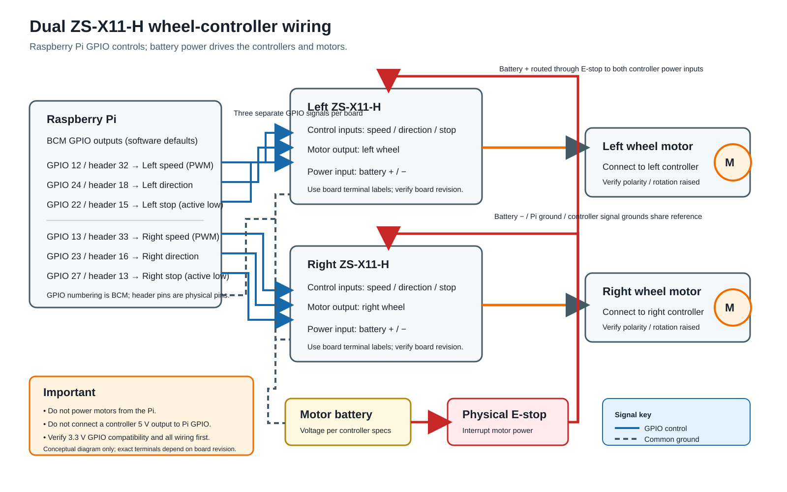
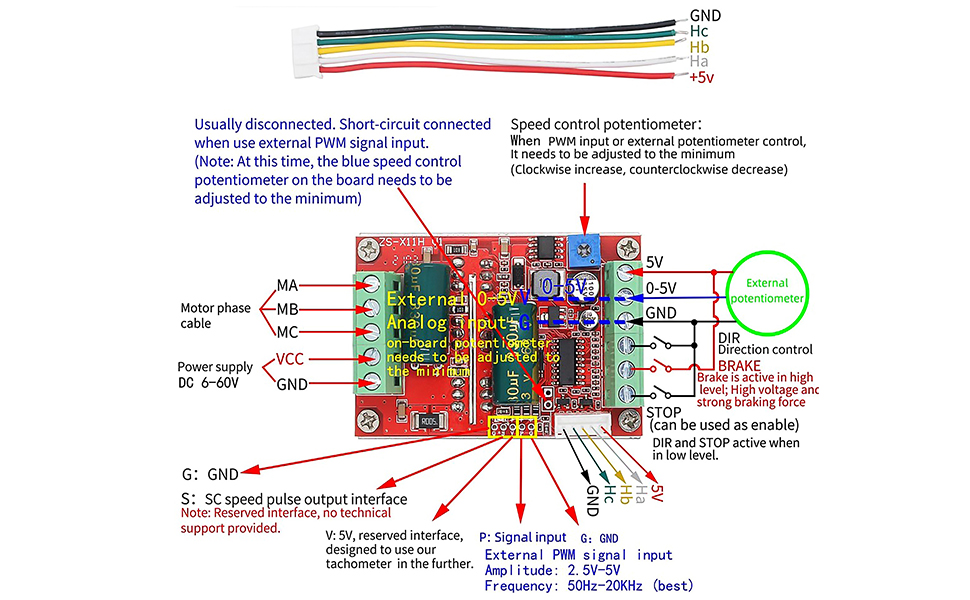
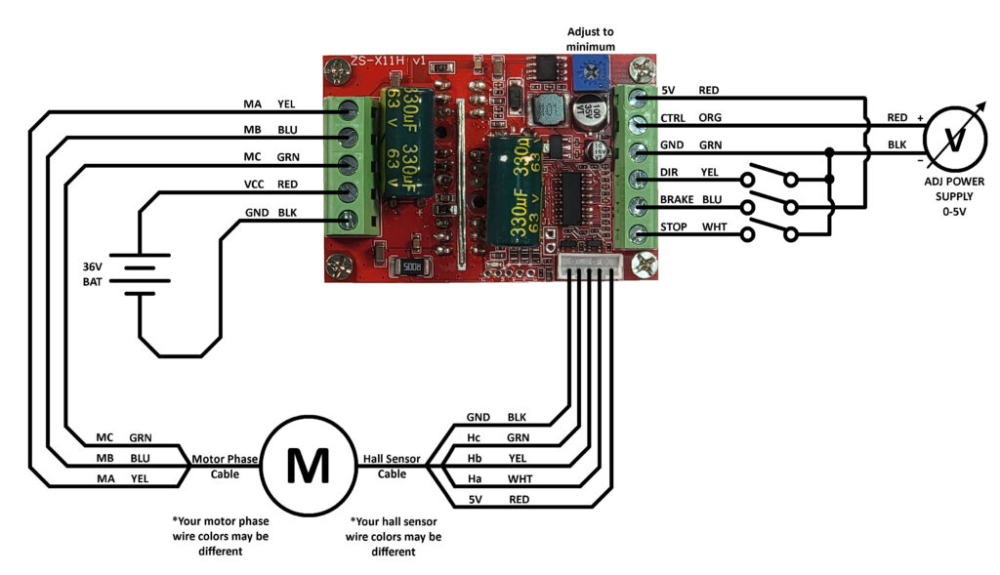

# Phase 2: manual RC motor control

Phase 2 supports two mutually exclusive RC drive targets on the same Raspberry Pi:

- Roboteq MDC2250: `Taranis X9 Lite → XM+ SBUS → Raspberry Pi → USB serial → Roboteq`
- Pair of RioRand ZS-X11-H boards: `Taranis X9 Lite → XM+ SBUS → Raspberry Pi GPIO → ZS-X11-H pair`

Start the executable manually with exactly one `--controller` target. It opens and commands only the selected controller; do not run two instances or switch targets while a model is connected. There is no installed, enabled, or required drive service. The existing `roberta_rc_monitor` remains available for checking all SBUS channels without opening a motor controller.

## Safety before connecting drive power

- Keep the frame securely raised with both drive wheels clear of the ground for initial tests. Keep people, cables, and loose items clear of the wheels.
- Have a verified, independent physical motor-power emergency stop immediately accessible. Do not rely on Ctrl-C, the radio failsafe, or this program as the only emergency stop.
- Verify the Roboteq's serial protocol, baud rate, channel operating modes, motor wiring, and motor/controller configuration against the MDC2250 documentation and this robot's wiring. In particular, verify the controller's command watchdog/failsafe behavior for a disconnected or crashed host before powering the motors.
- For the ZS-X11-H boards, verify the speed, direction, and stop connections against the board documentation and the robot wiring. The defaults below are carried over from the previous-version controller source and are not proof of the current wiring. The board reference shows a 50 Hz–20 kHz external PWM input, a 2.5–5 V PWM signal, and low-level direction/stop control. The Pi outputs 3.3 V logic; verify that the exact board version recognizes it. Never connect a board 5 V output to a Pi GPIO.
- Before using external PWM on a ZS-X11-H, follow its instructions for disabling/minimizing its on-board speed potentiometer. Test one board at a time with the drive wheels raised, the physical emergency stop ready, and the low PWM cap in place.
- Verify wheel direction with the drive wheels raised and the motor command limit kept low. Stop and correct the channel inversion/wiring if a wheel turns the wrong way. Do not test direction with the wheels on the ground.
- Keep transmitter failsafe configured to stop the receiver outputs. The runtime rejects SBUS failsafe and lost-frame data, stops both motor outputs when the link goes stale, and disarms after link loss. A restored link does not resume motion: both sticks must be neutral for the configured arm hold time.

The program can command motor torque. A raised frame reduces the risk of unintended vehicle motion but does not eliminate pinch, entanglement, or electrical hazards.

## Install/build on Raspberry Pi OS

Follow the hardware checks and run the installer described in [the Phase 1 setup guide](phase1-setup.md). The installer builds and installs both `/usr/local/bin/roberta_rc_monitor` and `/usr/local/bin/roberta_rc_drive`, and places an example configuration at `/etc/uv-roberta/rc-drive.conf` only if one does not already exist. It does not create, enable, or start a service.

If the SBUS monitor is not already commissioned, first run:

```bash
/usr/local/bin/roberta_rc_monitor
```

Use the monitor to verify live receiver data and identify which SBUS channels correspond to the throttle and steering sticks. Exit with Ctrl-C.

## Configure and calibrate

Review the config:

```bash
sudoedit /etc/uv-roberta/rc-drive.conf
```

Set `receiver_gpio` to the BCM GPIO connected to SBUS. Set `throttle_channel` and `steering_channel` to the observed channel numbers (1–16); the example values are only placeholders. The Roboteq device defaults to `/dev/serial/by-id/usb-Roboteq_Motor_Controller_MDC2XXX-if00`; change `roboteq_device` in the config if this controller appears at another path. An empty `roboteq_device` setting also uses this default. Set `roboteq_baud` to the controller's configured baud rate. The configured left/right Roboteq channels must be distinct channels 1 and 2.

The ZS defaults are BCM GPIO 12/24/22 for left speed/direction/stop and 13/23/27 for right speed/direction/stop, matching [the legacy controller header](../to-delete/controller/controller.h) and [implementation](../to-delete/controller/controller.cpp). Verify the wiring and that these GPIOs do not conflict with your SBUS pin before powering the boards. The Pi generates 800 Hz PWM; `zs_max_pwm=51` limits duty to 51/255 (20%) at full stick, with channel 10 further selecting one-third, two-thirds, or the full configured cap. The board wiring reference also calls for its external-PWM selection link and speed potentiometer set to minimum; verify the exact jumper configuration on your board. Keep this commissioning cap until direction and stop behavior are verified. The right direction is inverted by default to match the old source; set either `zs_*_direction_inverted` value as needed after a raised-wheel test.

The following are software defaults, not confirmation of the installed harness. BCM numbers differ from physical header pin numbers:



| Function | BCM GPIO | Pi physical header pin |
| --- | ---: | ---: |
| SBUS receiver input | 17 | 11 |
| Left ZS speed (PWM) | 12 | 32 |
| Left ZS direction | 24 | 18 |
| Left ZS stop (active low) | 22 | 15 |
| Right ZS speed (PWM) | 13 | 33 |
| Right ZS direction | 23 | 16 |
| Right ZS stop (active low) | 27 | 13 |





Use the board connector labels rather than wire color alone; the photo and wiring drawings are references and do not verify the installed board revision or harness.

Keep `max_motor_command` at the conservative example value of 200 (20% of the controller's command range) or lower for commissioning. The transmitter's channel 10 three-position switch sets the active cap to one third when low, two thirds when medium, and the configured `max_motor_command` when high. For example, with `max_motor_command=200`, those caps are approximately 66, 133, and 200. The low/medium/high positions are classified from the SBUS range (172–1811); check channel 10 in monitor mode and verify all three positions before arming. An out-of-range channel 10 value is treated as invalid RC input and stops the motors. This is a software command cap, not a guarantee of a particular wheel speed or torque. Do not raise the configured cap until low-limit operation, motor directions, stop behavior, and the physical emergency stop have been verified.

Calibrate the sticks using the observed channels. The calibration process does not open or command the motor controller:

```bash
sudo /usr/local/bin/roberta_rc_drive \
  --config /etc/uv-roberta/rc-drive.conf \
  --calibrate
```

Follow the prompts to hold throttle at minimum, neutral, and maximum, then repeat for steering. The tool saves the captured endpoints and center to the configuration. Re-run calibration if transmitter endpoints or channel assignments change. If an axis acts in the wrong direction during the raised-wheel test, set that axis's `*_inverted=true`, save the config, and repeat the test.

Before opening the motor controller, verify the receiver mapping and calibration again in monitor mode:

```bash
/usr/local/bin/roberta_rc_drive \
  --config /etc/uv-roberta/rc-drive.conf \
  --monitor
```

This mode does not open or command either motor controller.

## Start and stop manual drive

With the intended model/controller connected, the frame still securely raised, people clear, the physical stop ready, and both sticks neutral, choose one target:

```bash
/usr/local/bin/roberta_rc_drive \
  --config /etc/uv-roberta/rc-drive.conf \
  --controller roboteq \
  --arm
```

For the model with the two ZS-X11-H boards, use instead:

```bash
/usr/local/bin/roberta_rc_drive \
  --config /etc/uv-roberta/rc-drive.conf \
  --controller zs \
  --arm
```

The program opens only the selected controller, commands a stop, and waits for valid SBUS frames with both sticks neutral continuously for `arm_neutral_ms` (2 seconds by default). Once armed, throttle controls forward/reverse and steering mixes left and right outputs. Channel 10 selects the active motor-command cap: low = 33%, medium = 66%, high = 100% of the configured cap. `deadband` suppresses small stick movement around center; per-axis inversion and per-motor inversion are independently configurable.

While running in a terminal, `roberta_rc_drive` refreshes a fixed live table in place rather than scrolling. The RC channel names and values run vertically in the first two columns, followed by normalized inputs and motor commands. For the ZS controller, the third and fourth columns list the left driver's PWM, direction, and stop values, then the right driver's values beneath them. When output is redirected, it prints timestamp-free tables for logging.

Move one stick at a time and confirm each wheel's direction at the low command limit. Check each channel 10 switch position first at neutral, then test throttle, steering, neutral stop, and transmitter-off/failsafe behavior. If the SBUS link is lost or marked failsafe, or channel 10 is invalid, both channels are commanded to zero and the drive disarms. After restoring valid input, return both sticks to neutral and wait for the full arm hold again before any motion is accepted.

Press Ctrl-C to exit; the program sends zero commands and asserts the stop inputs on normal shutdown. If it reports a serial, GPIO, or controller error, use the physical emergency stop and investigate before restarting. The runtime has no dashboard/network control path.

## Test a controller without RC input

To isolate the motor controller from the receiver, run the bounded test mode with an explicit controller selection:

```bash
/usr/local/bin/roberta_rc_drive \
  --config /etc/uv-roberta/rc-drive.conf \
  --controller zs \
  --test-controller
```

This mode does not initialize or read the RC receiver. It requires an interactive terminal and an explicit `TEST` confirmation, then pulses each wheel forward and reverse separately for 500 ms with stop intervals. ZS PWM is capped at 25/255; Roboteq commands are capped at 100 units (or the configured maximum, if lower). Securely raise the wheels, clear people and objects from the wheels, and keep the physical emergency stop within reach before confirming. Ctrl-C interrupts the sequence and the program stops the outputs.

## Command reference

```text
roberta_rc_drive --config PATH --monitor
roberta_rc_drive --config PATH --calibrate
roberta_rc_drive --config PATH --controller roboteq --arm
roberta_rc_drive --config PATH --controller zs --arm
roberta_rc_drive --config PATH --controller zs --test-controller
```

Exactly one mode is required. `--monitor` and `--calibrate` do not open either motor controller. For backward compatibility, `--arm` without `--controller` selects `roboteq`; specify `--controller zs` for the ZS boards. `--test-controller` requires an explicit controller selection. The Roboteq target requires a configured `roboteq_device`. No systemd unit is installed or started by the setup script; start the executable manually only when ready to test.
